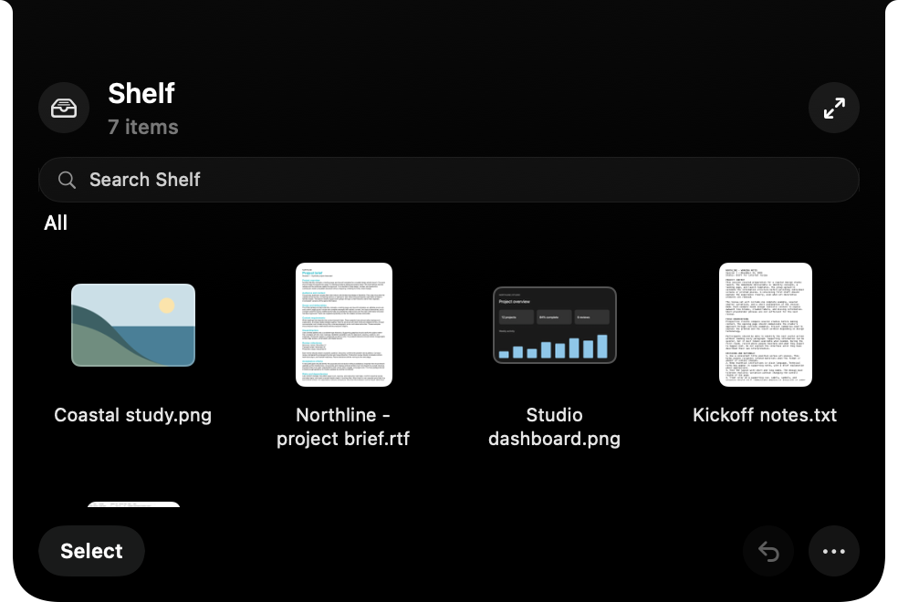
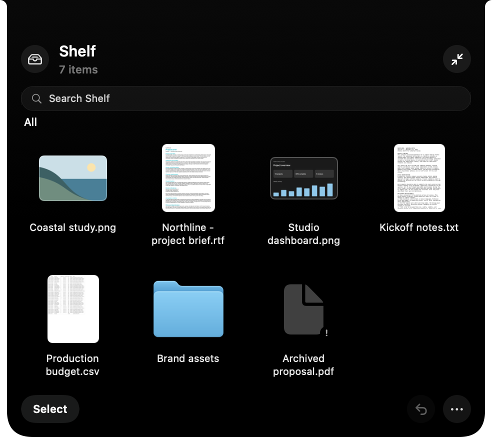
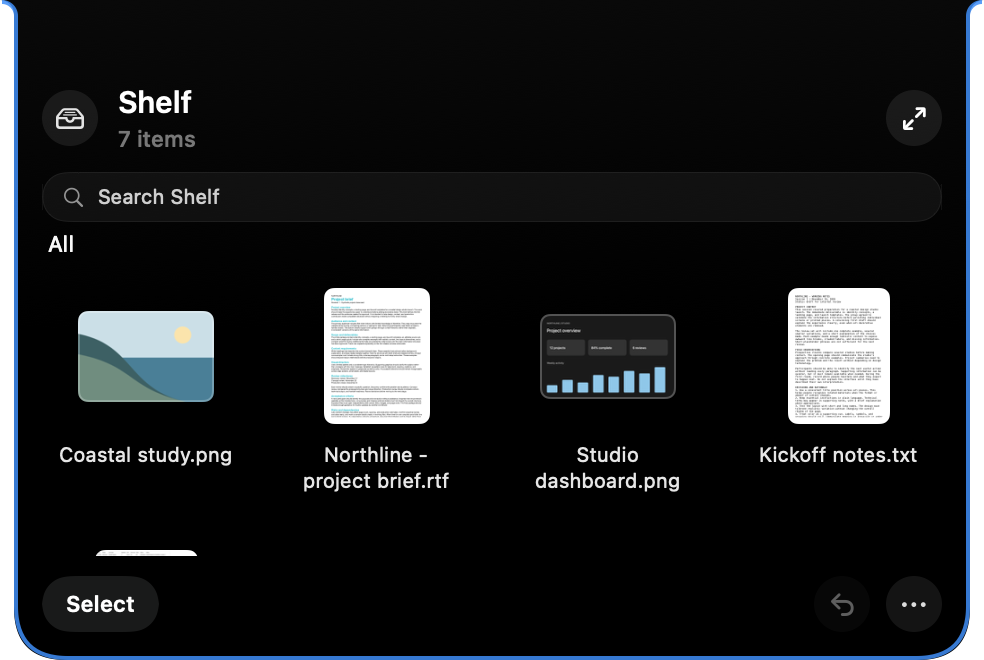
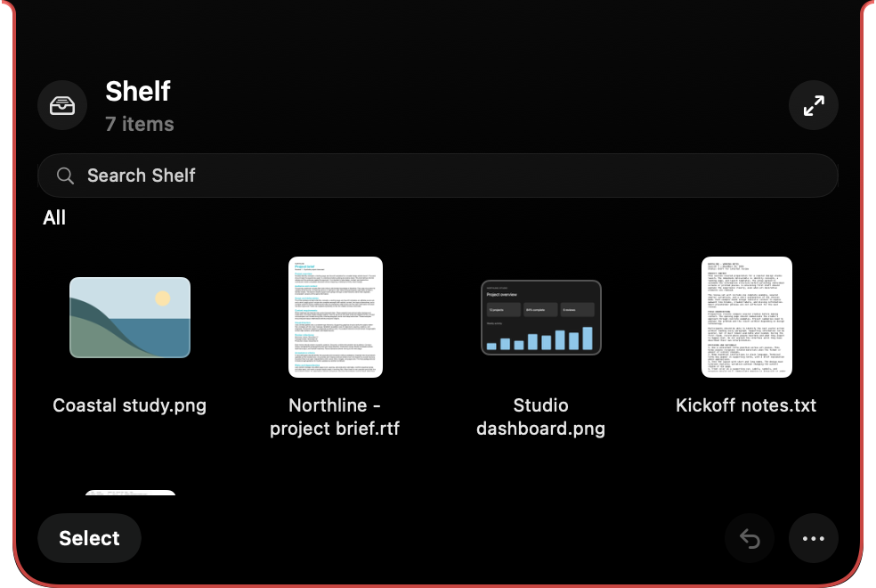
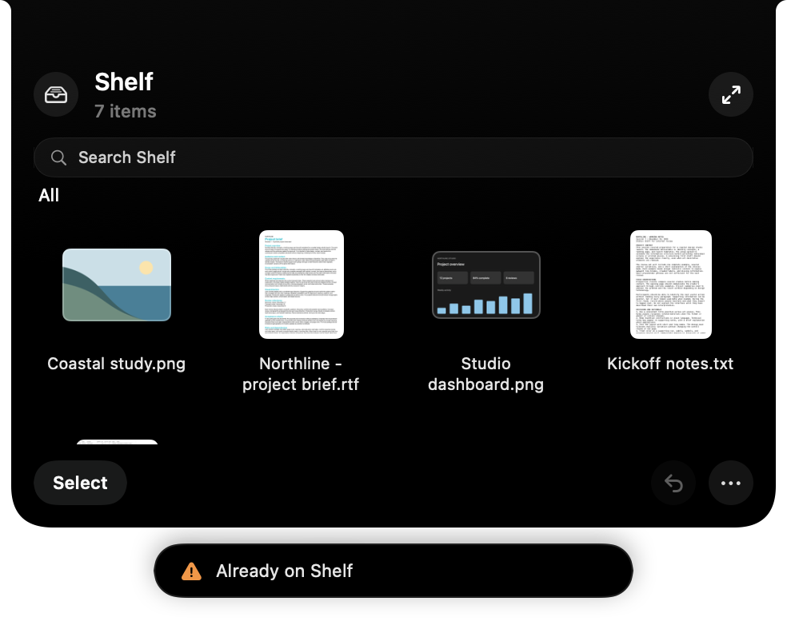

# Island and Shelf review previews

Generated from app code at `d773005` using isolated synthetic files and the production module host. These are offscreen snapshots; translucent materials can differ from compositor captures. The shortcut band is reserved, and static captures do not test drag detection, animation, or scrolling. The detached toast sample represents a pinned-open Island.

```sh
Scripts/render-module-previews.sh --module shelf \
  --scenario populated --scenario file-drag --scenario duplicate \
  --scenario notice-already-on-shelf --capture snapshot \
  --output /tmp/openyoink-pr-previews --no-open
```

| Regular | Extended |
| --- | --- |
|  |  |

| Accepted file drag | Duplicate file drag |
| --- | --- |
|  |  |


