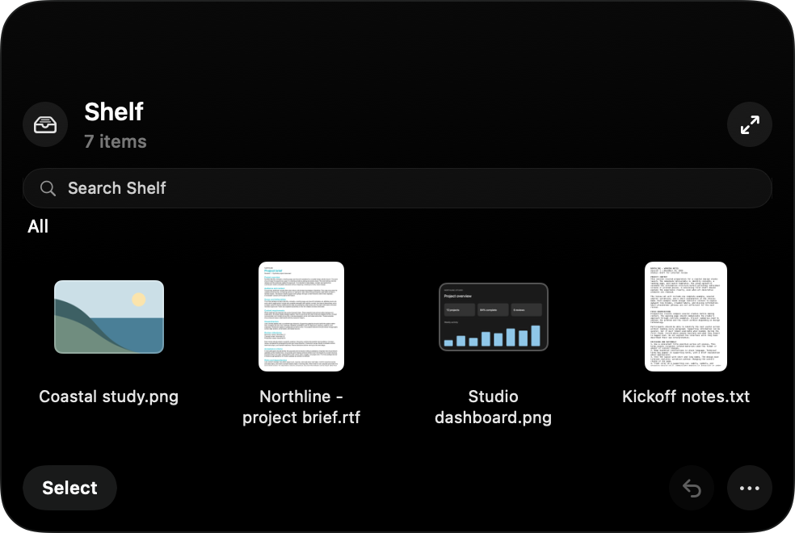
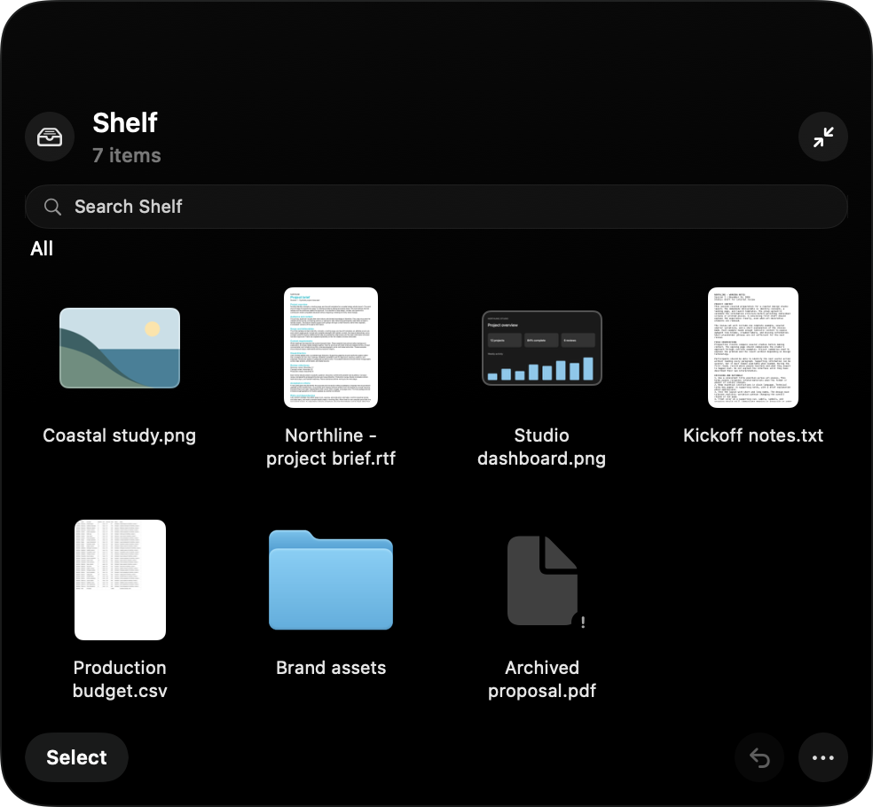
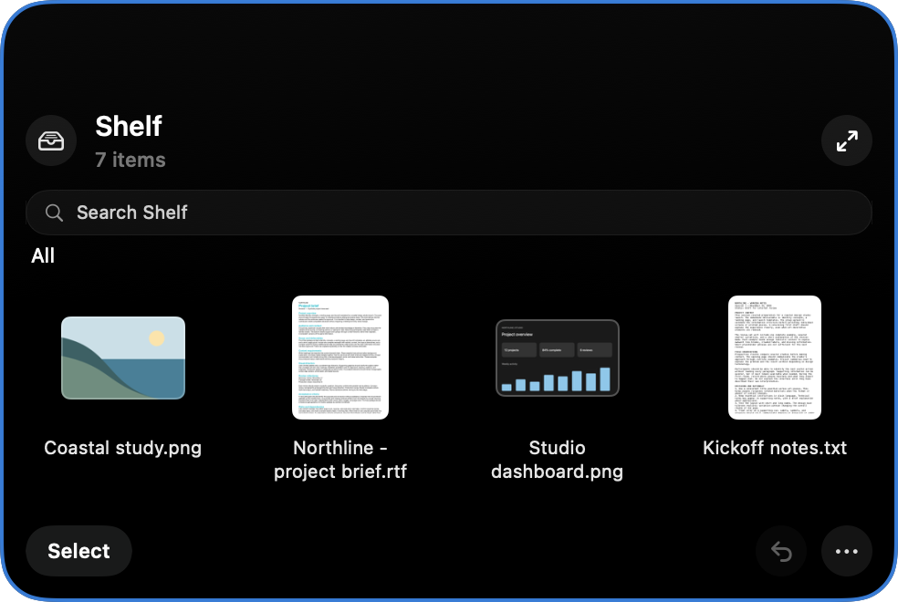
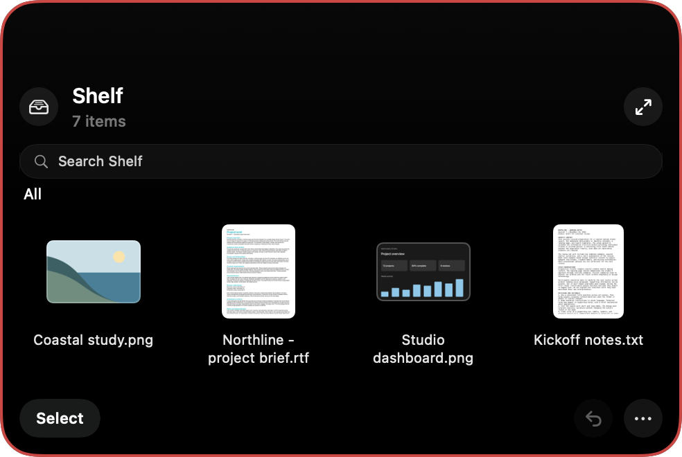
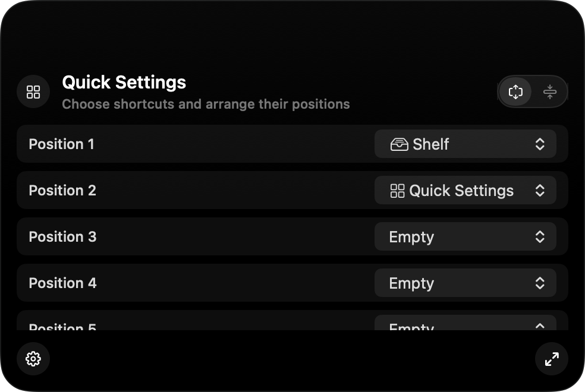
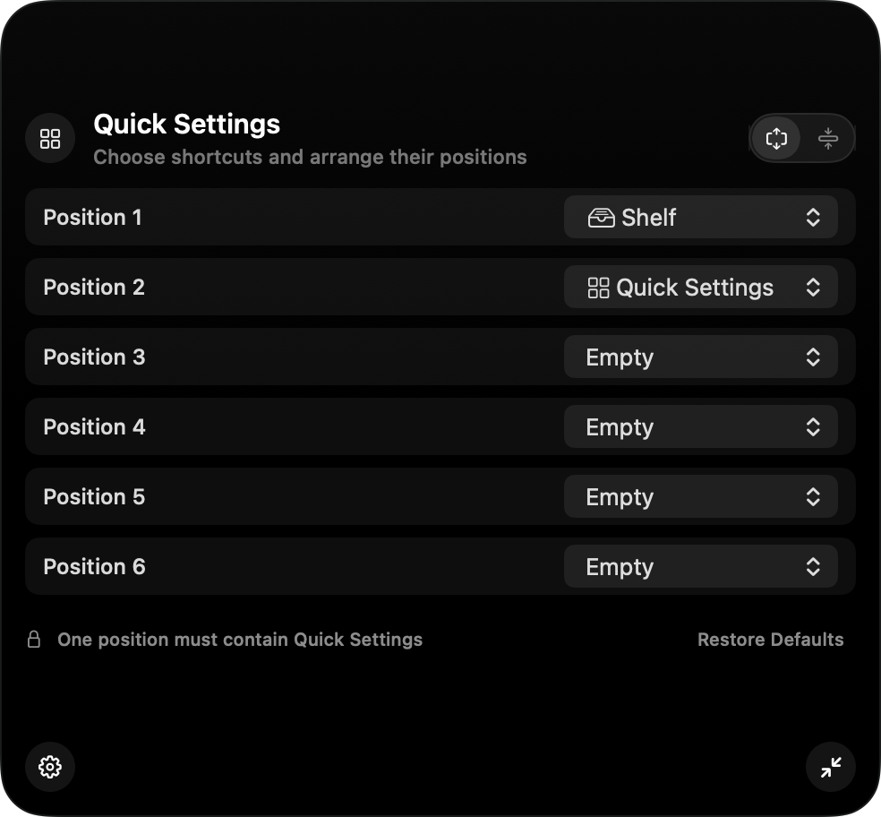

# Unified Island panel

Current review baseline for `codex/separate-expanded-panel`, following the [separate-panel prototype](../../prototypes/separate-expanded-panel/README.md). The prototype remains a historical checkpoint; this document describes the unified implementation.

## Settings organization

- **General**: startup, menu bar icon, language, and update checks.
- **Panel**: enablement, target display, hover/click/drag opening, delays, Shelf shortcut, mouse shake, shortcut positions, and ignored apps.
- **Notch**: optional notch companion, cycling shortcut, and module inclusion/order.
- **Modules**: experimental gate, module enablement, and each module's settings. Shortcut placement and notch inclusion are separate choices.
- **Storage**, **Debug** (debug builds), and **About** retain their dedicated pages.

Panel shortcut positions and Notch ordering use the same editor components and saved preferences as Quick Settings. Legacy Triggers and Ignored Apps links open Panel; Shelf and Clipboard links still open the relevant module settings. Existing preference keys are unchanged. Swift types, functions, and properties now use Notch names; the old compact preference keys and module raw values remain the storage format, and existing accessibility identifiers remain stable. Workflow presets respect the experimental gate and preserve hidden/unknown modules, including their saved shortcut positions.

## Behavior and ownership

- Every display uses the same floating expanded panel, rounded surface, content padding, toolbar, and animation. Hardware geometry determines placement, not a second expanded presentation.
- A notched display can additionally show notch display. **Settings → Notch → Show in notch** controls that companion. The preference is preserved when a selected display has no notch.
- Without compact, the top-center screen edge is the pointer trigger. Hover and click triggers each respect their own settings. File/text drag approach remains independent of hover reveal.
- Expanded shortcuts use one left-to-right configuration with up to eight positions. Visible capacity follows enabled modules, and Quick Settings occupies one required, movable position. Existing floating positions win the one-time migration; otherwise saved positions migrate in visual order. Notch ordering remains separate.
- `IslandNotchView` renders the companion; `IslandExpandedView` renders the expanded content. `IslandPresentationController` owns placement, native window coordination, and hover/swipe behavior. `ShelfWindowController` retains Shelf imports, keyboard routing, and the shared drag-host factory.
- `IslandSurfaceAnimationHost` keeps content mounted until closing finishes. A new opening cancels a stale close completion. One reveal value drives the background, border, shadow, and content mask.
- Activating the notch display preserves an existing pin while selecting its module; reopening an unpinned panel does not pin it.
- The shadow has drawing room outside the interactive surface. Those transparent margins do not accept clicks or file drops. Native hit testing uses the same continuous corner path as the visible surface, verified at regular and extended heights. Detached Shelf notices anchor to the visible panel, not its shadow canvas.
- File drags show a complete blue outline; duplicate drags show red. Insets use the same continuous rounded shape as the panel, including intermediate animation sizes.

## Automated validation — 2026-11-16

- **860 app tests passed**, with preview export run separately. Includes preference migration, display selection, compact visibility, click-trigger settings, shared module layout, drop bounds, rendering geometry, and interrupted close/reopen behavior.
- **146 preview captures exported successfully**: 140 Shelf and six Quick Settings images, covering regular/extended heights, complete blue/red drag outlines, notices, and transfer/recovery states. Representative populated, extended, outline, and Quick Settings captures were visually inspected; the entire gallery is available for review.
- **11 module-core tests passed**, including parameterized shortcut capacities from zero through twelve enabled modules, fixed positions, required Quick Settings, and persistence.
- The corner rendering regression failed with the old inset geometry and passed after using SwiftUI's rounded-shape inset. It compares both drag colors and all four corners at five reveal sizes against an independent rounded-rectangle reference.
- Xcode app tests exited successfully. Existing compiler warnings remain; this change does not claim a warning-free build.
- Native UI tests are separate from these counts. On 2026-11-17, **all 12 UI scenarios passed in one run** (148.7 seconds, zero failures): empty Shelf, compact pin retention, hover open/leave/reopen and pinned persistence, expanded navigation/pin/collapse, compact-off and simulated-notchless presentation, Settings navigation and picker menus, the core accessibility audit, cross-app file/text drops, duplicate notice/count, and Quick Look keyboard focus return. Run [`Scripts/test-ui.sh`](../../../Scripts/test-ui.sh); setup and limitations are in the [UI-test guide](../../../Scripts/README-ui-tests.md).

Commands from the repository root:

```sh
swift test --package-path Packages/OpenYoinkModuleCore
xcodebuild test -quiet -project Open-Yoink.xcodeproj -scheme OpenYoink \
  -destination 'platform=macOS' -derivedDataPath /tmp/openyoink-derived \
  -only-testing:OpenYoinkTests -skip-testing:OpenYoinkTests/IslandModulePreviewTests \
  CODE_SIGNING_ALLOWED=NO
Scripts/render-module-previews.sh --module shelf --module quick-settings \
  --capture snapshot --output /tmp/openyoink-unified-panel-review --no-open
```

## Preview scope

The gallery uses synthetic files and isolated stores with the production module host, expanded surface, height resolver, and drag-outline renderer. Shelf and Quick Settings include regular and extended states. Navigation space is reserved; these module captures do not show live shortcut buttons, the notch display, or the native window shadow. Snapshot capture does not prove blur/material fidelity, hover timing, scrolling, window stacking, or animation. Live rendering tests cover intermediate animation states separately.

The full generated gallery and manifest are local artifacts under `/tmp/openyoink-unified-panel-review`. The representative images below are tracked so a reviewer can inspect the resulting layout without running the app.

## Live acceptance matrix

Record outcomes separately from fixture/test passes. A simulated notchless display does not substitute for physical monitor attachment, scaling, or Spaces behavior.

| Check | Required observation | Status |
| --- | --- | --- |
| Compact enabled | Compact remains at cutout while expanded opens independently | Native UI tests pass for hover reveal and compact activation retaining the expanded pin |
| Compact disabled | No notch display; top-edge reveal still works | Native expanded launch/collapse and absence of compact pass; top-edge reveal still unverified |
| Simulated notchless | Same expanded layout; compact unavailable, preference retained | Native expanded launch/collapse and absence of compact pass; preference retention verified in Settings |
| Shelf keyboard / Quick Look | Selection, arrows, Space, and Escape stay in the intended window | Native Quick Look navigation, Space/Escape close, and keyboard focus return pass |
| Pin and menus | Pinned panel survives leaving; open menus do not cause collapse | Native pin/unpin, compact activation retaining pin, and pinned pointer departure pass; expanded menu tracking pending |
| File/text drag and duplicates | Approach opens Shelf, drops succeed, duplicate feedback follows release | Native cross-app synthetic file/text drops and duplicate notice/count pass; Finder/Show Desktop checks remain |
| Hover travel and rapid reentry | Gap stays open; leaving closes; reentry interrupts closing safely | Native open/leave/reopen and travel to pin control pass; interrupted rapid reentry remains a hands-on check |
| Show Desktop and Spaces | No stuck or misplaced panel; dragging still works afterward | Pending physical gesture check |
| External display / reconnect | Placement, fallback, and optional compact follow the chosen display | Pending physical display check |
| Reduce Motion / VoiceOver | Immediate reveal with correct focus and readable controls | Pending accessibility check |

The initial computer-use attempt could manipulate Settings but could not reliably target the separate expanded window. The repaired XCTest suite now targets the production panels by accessibility identifier across element types (AppKit exposes them as dialogs). Local signing fixes the rejected runner, and isolated launch preferences/data keep tests independent of the user's Shelf. Cross-app synthetic file/text drops, duplicate notice/count, and Quick Look keyboard focus now have native UI coverage. Finder-specific drag behavior, expanded menu tracking, rapid interrupted hover, Spaces, and physical display checks remain outstanding.

## Refreshed captures

| Shelf regular | Shelf extended |
| --- | --- |
|  |  |

| File drag | Duplicate drag |
| --- | --- |
|  |  |

| Quick Settings regular | Quick Settings extended |
| --- | --- |
|  |  |

Quick Settings' default-modules fixture enables the experimental gate for configuration coverage. That does not change the app's default gate setting.
