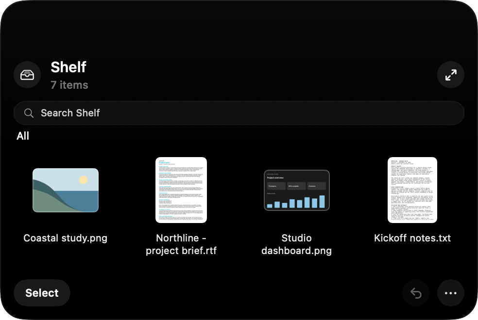
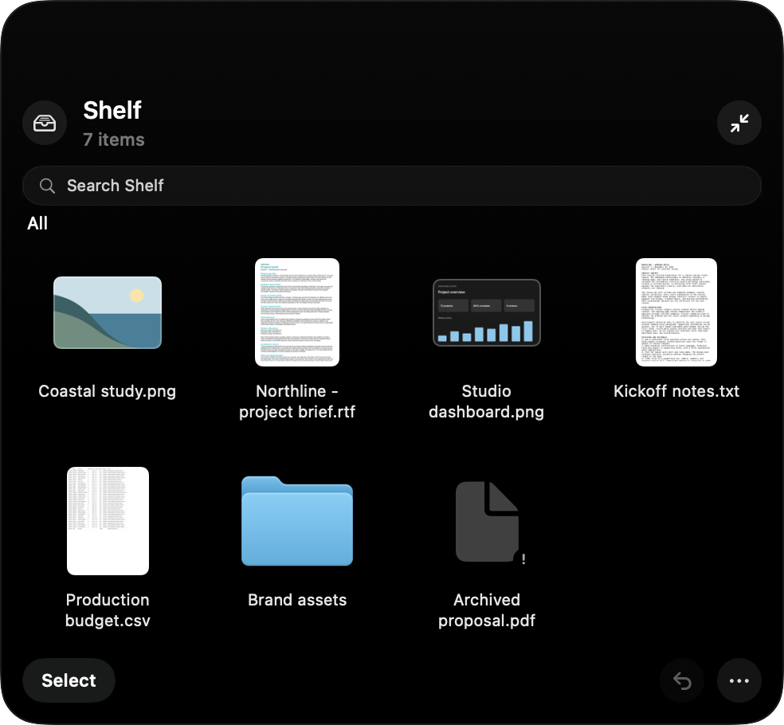
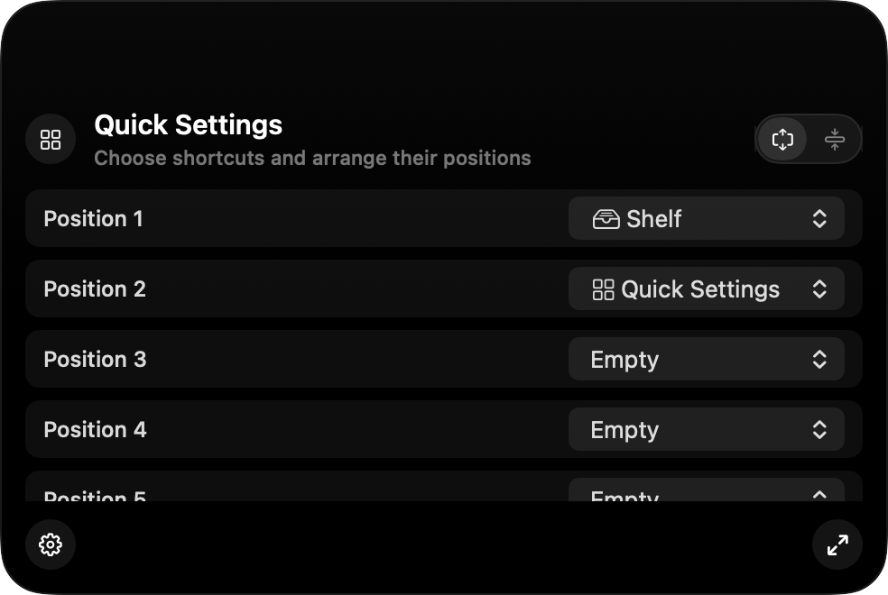
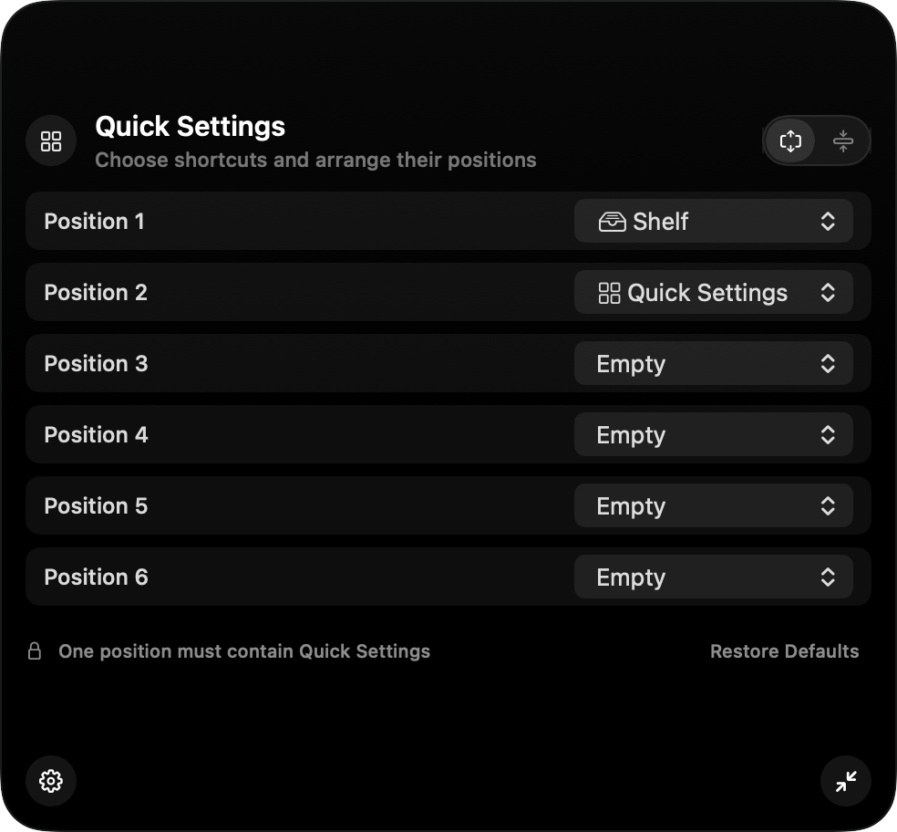

# Separate expanded panel checkpoint

This checkpoint on `codex/separate-expanded-panel` preserves the working prototype before the structural changes in [issue #3](https://github.com/Nininunz/OpenYoink/issues/3). Its base is merged [PR #2](https://github.com/Nininunz/OpenYoink/pull/2), commit `4b54eb5`.

## Current behavior

- On notched displays, compact stays in a separate window at the camera housing. Expanded opens eight points below it.
- Expanded uses the existing notchless rounded reveal animation, toolbar, shortcut positions, and content padding.
- The compact window cannot take keyboard focus. Pointer travel through the gap keeps the expanded panel open without an input window covering the gap.
- The expanded host owns transition completion and native window sizing. It stays at its expanded frame while hidden, avoiding SwiftUI minimum-size jumps during collapse.
- Drag outlines use the same reveal mask as expanded. Existing Shelf content, import handling, and detached toasts remain shared.

## Refactor boundary

This is not the completed architecture for issue #3. `compactOnly`, `hasSeparateExpandedPanel`, `expandedUsesNotch`, and `separatesExpandedPanel` still bridge the old and new presentations. The shared window factory and Island event handling still live in `ShelfWindowController`.

The next change should extract the expanded and compact views/controllers, introduce the optional compact setting, and migrate to one expanded shortcut configuration. Saved notched and notchless shortcut positions still coexist in this checkpoint. Keep these concerns in that refactor instead of partially migrating preferences during cleanup.

## Validation baseline

- Before merging PR #2, **849 app tests passed**, including the complete module preview export, on macOS 27.2.1. The overall Xcode run exited 65 because `OpenYoinkUITests-Runner` was killed before establishing its connection. The UI-test suite did not execute successfully.
- The separate-panel prototype passed **76 focused tests** covering geometry, activity/hover coordination, notice panels, shortcut persistence, and imports.
- After switching to the existing notchless animation, **17 geometry and outline tests passed**. These overlap the preceding run; they are not an additional full-suite count.
- After checkpoint cleanup, the preview runner rebuilt the app and exported the four captures below. `git diff --check` passed.
- Live diagnostics confirmed expanded open/close transitions keep the same native frame. Trackpad Spaces behavior, complete drag/Quick Look workflows, and interrupted animations still need hands-on verification; static captures do not establish those behaviors.

## Visual baseline

These captures use production module content and the expanded host with synthetic data. The navigation band is reserved rather than populated with live shortcuts. They do not include the compact companion, native window shadows, or hover/drag lifecycle. Quick Settings uses the test kit's existing “Default modules” fixture, which enables experimental modules for configuration coverage.

| Shelf regular | Shelf extended |
| --- | --- |
|  |  |

| Quick Settings regular | Quick Settings extended |
| --- | --- |
|  |  |

Reproduce from the repository root:

```sh
Scripts/render-module-previews.sh --module shelf --module quick-settings \
  --scenario populated --scenario 'Default modules' --capture snapshot \
  --output /tmp/openyoink-separate-panel-checkpoint --no-open
```

The local `.vscode/settings.json` only contains personal editor colors and is ignored. No app data or user-file screenshots are included in this checkpoint.
